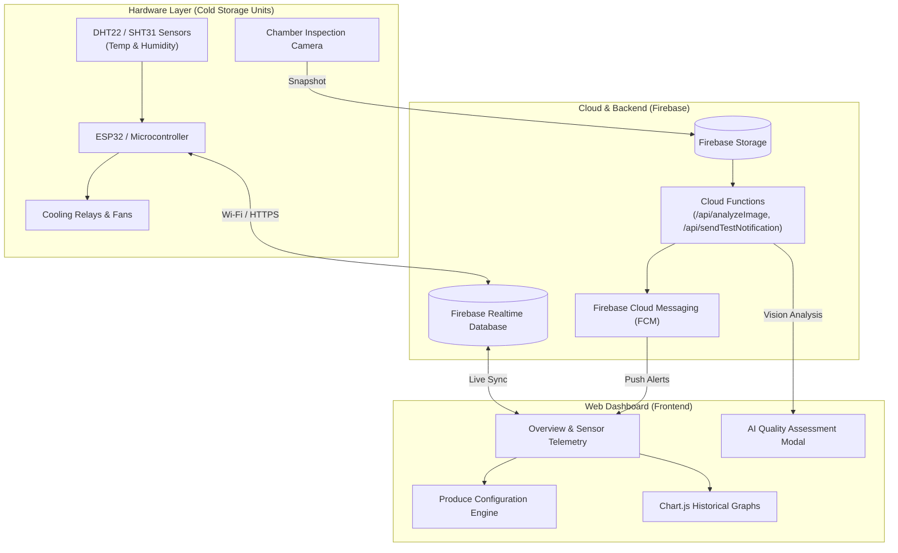

# ❄️ Smart Fruit & Vegetable Cold Storage Management System

[](https://firebase.google.com/)
[](https://espressif.com/)
[](https://cloud.google.com/)
[](https://www.chartjs.org/)


An intelligent, multi-chamber IoT cold storage monitoring and automation system engineered to minimize post-harvest losses in agricultural produce. It combines real-time climate telemetry, crop-specific storage logic, automated cooling actuation, and AI-powered visual quality inspection.

---

## 📌 Table of Contents
- [Overview](#-overview)
- [Key Features](#-key-features)
- [System Architecture](#-system-architecture)
- [Produce Database Reference](#-produce-database-reference)
- [Project Structure](#-project-structure)
- [Hardware & IoT Integration](#-hardware--iot-integration)
- [Installation & Setup](#-installation--setup)
- [Running the Application](#-running-the-application)


## 🌟 Overview

Fresh fruits and vegetables require strict climate maintenance to preserve nutritional value and prevent microbial decay and chilling injury. Traditional cold storage facilities often rely on manual oversight or single-temperature controls across different produce types.

This **Smart Cold Storage System** addresses these challenges by offering:
- **3 Independent Storage Chambers** with isolated microclimates.
- **Dynamic Produce Presets** matching scientific post-harvest temperature and humidity ranges.
- **AI Computer Vision Inspection** directly from the chamber camera feed to detect produce decay and categorize batches into Good, Warning, and Spoiled counts.
- **Live Automated Alerts & Alarms** with audio warnings and Firebase push notifications.

---

## ✨ Key Features

### 1. 🎛️ Multi-Chamber Real-Time Dashboard
* **Independent Telemetry**: Continuous monitoring of Temperature (°C) and Relative Humidity (%) for Chamber 1, Chamber 2, and Chamber 3.
* **Intelligent Cooling Control**: Real-time display of compressor/fan status (`ON` / `OFF`) driven by target temperature logic.
* **Status Indicators**: Instant visual status updates (`NORMAL`, `WARNING`, `CRITICAL`).

### 2. 🥦 Built-in Produce Knowledge Base (`crop-database.js`)
* Configured profiles for diverse fruits and vegetables including **Tomato, Green Chilli, Cucumber, Brinjal, Carrot, Potato, Onion, Cabbage, Lettuce, Apple, Banana, Orange, Mango, Strawberry, Grapes**, plus custom produce entries.
* Each crop profile contains:
  * Recommended temperature range (°C) & optimal target
  * Recommended humidity range (%)
  * Estimated storage lifespan
  * Chilling injury sensitivity thresholds

### 3. 🧠 AI Visual Quality Assessment
* In-app camera integration for live snapshot capture of produce in any chamber.
* AI-driven visual defect inspection:
  * **Overall Batch Condition** (`Fresh`, `Fair`, `Spoiled`)
  * **Item Count Breakdown** (Good, Warning, Spoiled)
  * **Confidence Score** and inspection timestamps.

### 4. 📊 Analytics & Time-Series History
* Interactive time-series charts powered by **Chart.js**.
* Real-time plotting of Temperature vs. Time and Humidity vs. Time across all active chambers.

### 5. 🚨 Smart Alert & Warning System
* Automatic deviation detection when environmental conditions fall outside acceptable crop bounds.
* **Audible Web Alarm**: Interactive browser sound alarm toggle for on-site operators.
* **Push Notifications**: Cloud-integrated notifications via Firebase Cloud Messaging (FCM).

### 6. 🔄 Dual Operational Modes
* **Live Firebase Mode**: Connects directly to the live Firebase Realtime Database for hardware sensor streams.
* **Demo / Simulation Mode**: Built-in simulation generator to evaluate and test UI, threshold alerts, and AI workflows without requiring live hardware.

---

## 🏗️ System Architecture



---

## 📂 Project Structure

```plaintext
cold-storage/
├── .firebaserc                # Firebase project configuration
├── firebase.json              # Hosting, Functions, and Database rewrite rules
├── database.rules.json        # Security rules for Firebase Realtime Database
├── index.html                 # Main dashboard UI (responsive layout)
├── style.css                  # Custom styling (modern dark-theme interface)
├── app.js                     # Core application logic, event listeners, and UI state
├── crop-database.js           # Comprehensive produce database with storage thresholds
├── firebase-config.js         # Firebase connection credentials and initialization
├── firebase-messaging-sw.js   # Service worker for Firebase background push notifications
├── public/                    # Production assets ready for Firebase Hosting deployment
│   ├── index.html
│   ├── style.css
│   ├── app.js
│   ├── crop-database.js
│   ├── firebase-config.js
│   └── firebase-messaging-sw.js
└── functions/                 # Backend Firebase Cloud Functions (Node.js)
    ├── package.json
    ├── package-lock.json
    └── index.js               # APIs for image analysis and notification broadcasting
```

---

## 🔌 Hardware & IoT Integration

To connect physical cold storage chambers to this system:
1. **Microcontroller**: ESP32 / ESP8266 or Arduino with Wi-Fi shield.
2. **Sensors**: DHT22, AM2302, or SHT31 temperature and humidity sensors (1 per chamber).
3. **Actuators**: 5V/12V relay modules wired to chamber compressor and circulation fans.
4. **Data Protocol**: Push sensor readings to Firebase Realtime Database under paths:
   ```json
   {
     "chambers": {
       "C1": { "temp": 14.8, "humidity": 72, "fan": false, "timestamp": 1731500000 },
       "C2": { "temp": 8.5,  "humidity": 80, "fan": false, "timestamp": 1731500000 },
       "C3": { "temp": 4.2,  "humidity": 88, "fan": true,  "timestamp": 1731500000 }
     }
   }
   ```

---

## 🚀 Installation & Setup

### Prerequisites
* A modern web browser (Chrome, Edge, Firefox, Safari).
* A [Firebase](https://firebase.google.com/) account (Free Spark plan is sufficient).
* [Node.js](https://nodejs.org/) (optional, required if deploying Firebase Cloud Functions).

### 1. Clone the Repository
```bash
git clone https://github.com/kalaiselvi2005975/cold-storage.git
cd cold-storage
```

### 2. Configure Firebase Credentials
1. Create a project in the [Firebase Console](https://console.firebase.google.com/).
2. Enable **Realtime Database** and **Cloud Storage**.
3. Update `firebase-config.js` with your Firebase project credentials:
   ```javascript
   const firebaseConfig = {
     apiKey: "YOUR_API_KEY",
     authDomain: "YOUR_PROJECT_ID.firebaseapp.com",
     databaseURL: "https://YOUR_PROJECT_ID-default-rtdb.firebaseio.com",
     projectId: "YOUR_PROJECT_ID",
     storageBucket: "YOUR_PROJECT_ID.appspot.com",
     messagingSenderId: "YOUR_MESSAGING_SENDER_ID",
     appId: "YOUR_APP_ID"
   };
   ```

### 3. Deploy Cloud Functions (Optional)
```bash
cd functions
npm install
firebase deploy --only functions
```

---

## 💻 Running the Application

### Option A: Local Testing with Any Static Server
You can launch the dashboard locally using VS Code Live Server, Python HTTP server, or any static server:
```bash
# Using Python
python -m http.server 8000

# Using Node http-server
npx http-server . -p 8000
```
Open your browser at `http://localhost:8000`.

### Option B: Deploying to Firebase Hosting
```bash
firebase login
firebase use --add
firebase deploy --only hosting
```

---


